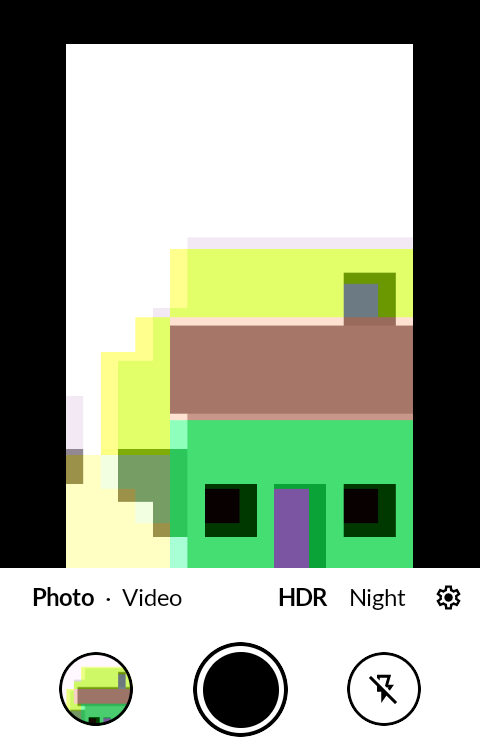
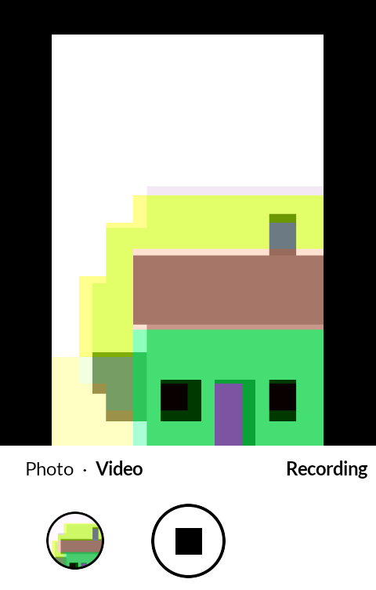
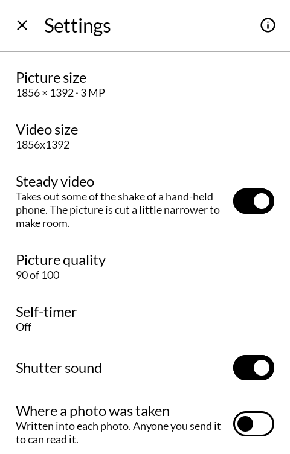
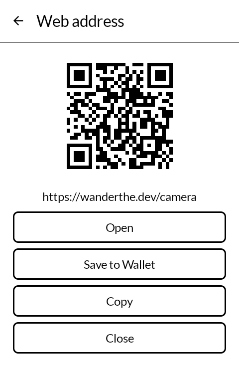

# Camera

写真機 *shashinki*

Photos and video on an E Ink phone, with the camera's own face kept out of the way: the
viewfinder, and below it the last picture, the shutter and the flash.

Built for the [Mudita Kompakt](https://mudita.com/products/kompakt/), whose 4.3" panel has
sixteen greys, a slow redraw, and is read outdoors as often as indoors. It is
[Open Camera](https://opencamera.org.uk) underneath.

## Screenshots

| | | | |
|---|---|---|---|
|  |  |  |  |

## What it does

- **Photos and video.** One line above the shutter switches between them. While recording,
  the shutter is a square and the line says so; there is no running clock.
- **The last picture** opens in Gallery (画廊 garō), inside its folder, whenever Gallery is
  installed, even if another gallery is the phone's default; otherwise in the phone's gallery.
- **Shadows, HDR and Night**, on the same line. One press of Shadows brightens the dark parts
  of a single shot (Open Camera's DRO), so it is as quick as a plain photo and fine handheld,
  with nothing to line up. A second press shows HDR, which joins three exposures so a bright sky
  keeps its detail; a third turns it off. Night joins several quick frames, for less grain in
  the dark, and says how many megapixels the picture will have, since the camera only does that
  at smaller sizes. All are Open Camera's own. HDR and Night say "Hold still" while they take
  their frames.
- **Flash** cycles through automatic, off and on in place, as Mudita's own camera does. On is
  a steady light, lit from the moment it is chosen, so the picture can be framed by it.
- **Tap the viewfinder** to focus there; pinch to zoom.
- **Codes are read as you point at them**, with no photo to take. The camera hands the reader
  its own grey copy of the picture, sharper than this screen can show, one frame after another
  as fast as they read. A QR code anywhere in the picture is focused on as soon as it is seen,
  and a square comes up over the middle of the viewfinder to aim with; a code in the square
  reads even when it is small, and the square also reads Data Matrix, Aztec and PDF417 codes
  and the barcodes on things in shops (EAN, UPC, Code 128, Code 39 and the rest). Outside the
  square a QR code is taken only once it fills a fair part of the picture, so a poster across
  the room is left alone. A read gives one short tick, and the code comes up on a screen of its
  own, drawn clean as the same kind of code, with what it is — a web address, a Wi-Fi network,
  a contact, an email, a phone number, a place, a sign-in code, a product, a book — and the one
  thing to do with it, handed to the app on the phone that does that: the browser, Android's own
  "save this network", Contacts, Email, Messaging, a map; a product or book barcode is looked
  up on the web. **Save to Wallet** keeps the code as a card in Wallet (札入 satsuire), where it
  is on the phone, to show to a scanner or open again. A two-step sign-in code offers **Add to
  Passwords** (合言葉 aikotoba) instead, where it is on the phone. Nothing opens until a button
  is pressed. Copy is always there. Reading can be turned off.
- **Other apps can ask it to scan.** It answers the request ZXing's Barcode Scanner made the
  custom (`com.google.zxing.client.android.SCAN`): the camera opens with the square up, and the
  first code read goes straight back to the app that asked.
- **Read code** in the share sheet reads a code out of a picture — a screenshot of a ticket, a
  photo of a poster — and shows it on the same screen.
- **Ten settings**: reading codes, picture size, video size, steady video, picture quality, a
  self-timer, the shutter sound, writing where a photo was taken into it, a grid, and the folder
  under DCIM. Steady video is on to begin with: the camera takes out some of the shake of a
  hand-held phone, and cuts the picture a little narrower to do it. It is there only on a camera
  that can.

Photos and videos go to `DCIM/Camera`, where Android's own camera puts them, unless the folder
is changed, so they appear in Gallery. With Gallery's backup turned on, Camera tells Gallery the
moment it has saved a photo, and it goes up to Immich then.

When the camera cannot be opened — on a Kompakt, usually because the switch on the left side
has turned it off — the screen says so, and it says so too if the camera stops or a photo
fails.

It uses Android's Camera2 interface, which the Kompakt's camera supports in full. Open Camera
on its own starts the Kompakt on the older interface, where photos come out black.

## What it does not do

No front camera (the Kompakt has none), no RAW (its camera cannot), no panorama,
bracketing, or manual controls: Open Camera has all of them, and keeps them, but nothing here
reaches them. Nothing is drawn over the viewfinder — no clock, level or histogram — because
on this panel everything drawn there is redrawn with every frame.

## How it is made

Open Camera does everything a camera does: it opens the camera, focuses, takes the picture,
records, and saves. Its own activity still runs. Its buttons are still there, laid out but
never shown, and every press here calls the same method of Open Camera's that its own button
would have. What is new is a Jetpack Compose layer over the viewfinder, built with
[MMD](https://github.com/mudita/MMD), Mudita's E Ink component library.

The changes to Open Camera's own code are small and each marked `shashinki`: the overlay
draws nothing, its sixty-a-second redraw is off, a few hooks let the new layer start and know
when the camera's state changes, and the camera's preview gains one more output, the grey copy
the code reader reads, made only for a plain photo session while reading is on. The first commit of this
repository is Open Camera exactly as upstream has it, so `git diff d084757` shows all of it.

## Building

```
./gradlew assembleRelease
```

A release is signed by a keystore in `signing/`, which is not in this repository. Without
it the release APK builds **unsigned** and will not install anywhere — there is no
fallback key by design.

## Credit

[Open Camera](https://opencamera.org.uk) by Mark Harman, GNU General Public License v3 or
later — the camera itself. Upstream: <https://sourceforge.net/p/opencamera/code/>.
Its third-party material is listed in its own credits: AndroidX (Apache 2.0), Google's
Material Design icons (Apache 2.0), and its sounds (CC0).

Icons in the new layer are [Material Symbols](https://fonts.google.com/icons), Apache
License 2.0. Codes are read by [ZXing](https://github.com/zxing/zxing), Apache License 2.0. The way of
reading them — the middle square at the camera's own sharpness, frame after frame — follows
[QR & Barcode Scanner](https://github.com/wewewe718/QrAndBarcodeScanner) by wewewe718 (The Unlicense).

The app's own **Licences** page (About) gives the source address, this list and the full text of
each licence, so none of it depends on this repository.

## Getting it, and keeping it

Download <https://github.com/wanderwildwood/shashinki/releases/latest/download/shashinki.apk>
and sideload it. That address always points at the newest release, and every release
publishes a `.sha256` beside the APK if you would rather check than trust.

For updates without doing this by hand, add this repository to
[Obtainium](https://github.com/ImranR98/Obtainium):

    https://github.com/wanderwildwood/shashinki

## Licence

GNU General Public License v3 or later, as Open Camera is. See [LICENSE](LICENSE).

Open Camera is © 2013–2026 Mark Harman. The changes and the new interface are © wander wildwood.
